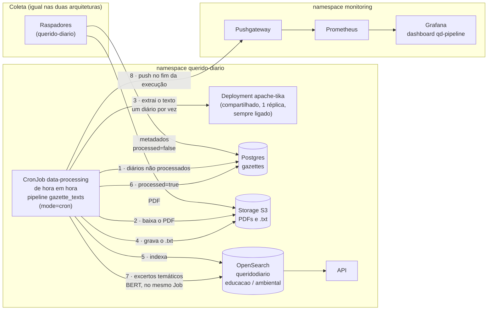
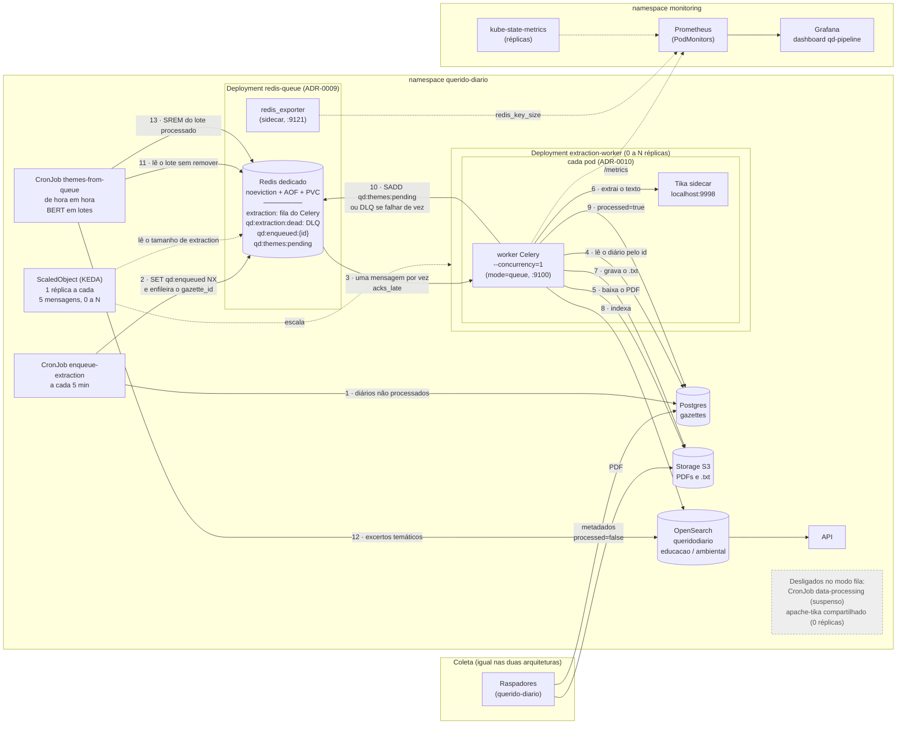

# Arquitetura do processamento: atual × proposta implementada

Este documento compara o processamento dos diários (extração do texto, indexação e excertos temáticos) na arquitetura atual, que é o baseline do experimento, e na arquitetura proposta, como foi implementada na Parte C. A coleta (raspadores, Scrapy Cloud e armazenamento dos PDFs) é a mesma nas duas e está em [arquitetura-legada-da-coleta-dos-diários.md](arquitetura-legada-da-coleta-dos-diários.md).

As duas arquiteturas convivem no `querido-diario-deployment` e se alternam pelo overlay:

| | Atual (baseline) | Proposta implementada |
|---|---|---|
| Overlay no kind | `k8s/overlays/dev` | `k8s/overlays/dev-queue` (`dev` + componente `queue-pipeline`) |
| Comando | `make k8s-local-queue-down` | `make k8s-local-queue` |
| Código | `querido-diario-data-processing`, pipeline `gazette_texts` | mesmo repositório, pacote `work_queue/` e pipelines `enqueue_extraction` e `themes_from_queue` |

## Arquitetura atual (baseline)

Um CronJob roda de hora em hora e processa, em sequência, todos os diários ainda não processados. O Tika é um Deployment compartilhado, sempre ligado. As métricas saem num push ao Pushgateway no fim de cada execução.

- **Latência:** um diário coletado espera até a próxima execução do CronJob, até 1 hora, antes de ser processado.
- **Paralelismo:** nenhum. Um Job processa um diário por vez, e o Tika compartilhado é o gargalo.
- **Custo em repouso:** o Tika compartilhado fica ligado mesmo sem trabalho.
- **Falhas:** um diário com erro é registrado no log e pulado. Ele continua `processed=false` e é tentado de novo na execução seguinte.

## Arquitetura proposta implementada

Um produtor enfileira o id de cada diário não processado num Redis dedicado. Workers, cada um com o próprio Tika, processam um diário por vez, e o KEDA escala os workers pelo tamanho da fila, de 0 até o teto. Os excertos temáticos rodam à parte, em lotes. As métricas dos workers e da fila são raspadas pelo Prometheus.

- **Latência:** o produtor roda a cada 5 minutos, e os workers começam assim que a fila tem mensagens.
- **Paralelismo:** réplicas = diários em paralelo (`--concurrency=1`). O teto é 6 no componente e 2 no overlay `dev-queue`, para caber no Docker de um notebook. A calibração fica para a D5.
- **Custo em repouso:** com a fila vazia, o KEDA leva os workers a 0, e com eles os Tikas. Só o `redis-queue` fica ligado.
- **Falhas:**
  - **Erro transitório** (rede, Tika reiniciando, Postgres fora do ar): até 5 novas tentativas com backoff. A conexão com o Postgres é refeita a cada tentativa.
  - **Erro definitivo** (arquivo sem suporte, PDF ausente no storage): o diário vai direto para a DLQ (`qd:extraction:dead`).
  - **Worker morto no meio de um diário:** a mensagem volta para a fila (`acks_late` + `task_reject_on_worker_lost`).
  - **Diário reprocessado:** não duplica, porque o índice sobrescreve o documento pelo checksum.
- **Temas:** o lote só sai de `qd:themes:pending` depois de passar por todos os temas. Se o Job morrer no meio, por exemplo por falta de memória no BERT, o lote é processado de novo na execução seguinte.

## Métricas (ADR-0011)

As duas arquiteturas emitem as mesmas séries (`qd_gazettes_processed_total`, `qd_gazette_processing_seconds` e `qd_scrape_to_index_seconds`), diferenciadas pelo rótulo `mode`. Só o caminho até o Prometheus muda:

| | Baseline (`mode=cron`) | Fila (`mode=queue`) |
|---|---|---|
| Processamento | push ao Pushgateway no fim do Job | `/metrics` do worker (porta 9100), raspado pelo PodMonitor `extraction-worker` |
| Fila e DLQ | — | `redis_exporter` (porta 9121), raspado pelo PodMonitor `redis-queue` |
| Réplicas | — | `kube_deployment_status_replicas` (kube-state-metrics) |
| CronJobs da fila | — | rodam com `PUSHGATEWAY_URL=""`, para não substituir o grupo `job="data-processing"` do baseline no Pushgateway |

## Onde está cada peça

| Peça | Repositório | Arquivo |
|---|---|---|
| App Celery e broker | `querido-diario-data-processing` | `work_queue/celery_app.py` |
| Task `extract_gazette`, retries e DLQ | `querido-diario-data-processing` | `work_queue/tasks.py` |
| Chaves do Redis | `querido-diario-data-processing` | `work_queue/redis_keys.py` |
| Pipelines `enqueue_extraction` e `themes_from_queue` | `querido-diario-data-processing` | `main/__main__.py` |
| Redis dedicado e exporter | `querido-diario-deployment` | `k8s/components/queue-pipeline/redis-queue.yaml` |
| Worker com Tika sidecar | `querido-diario-deployment` | `k8s/components/queue-pipeline/extraction-worker.yaml` |
| CronJobs da fila | `querido-diario-deployment` | `k8s/components/queue-pipeline/enqueue-cronjob.yaml` e `themes-cronjob.yaml` |
| KEDA | `querido-diario-deployment` | `k8s/components/queue-pipeline/scaledobject.yaml` |
| PodMonitors | `querido-diario-deployment` | `k8s/components/queue-pipeline/monitoring/` |
| Overlay e limites locais | `querido-diario-deployment` | `k8s/overlays/dev-queue/kustomization.yaml` |

Decisões: [ADR-0009](../adrs/0009-fila-de-extracao-com-celery-e-redis-dedicado.md) (broker e fila), [ADR-0010](../adrs/0010-tika-como-sidecar-dos-workers-de-extracao.md) (Tika sidecar) e [ADR-0011](../adrs/0011-observabilidade-com-prometheus-e-grafana.md) (observabilidade). Validação funcional dos dois modos em [validacao-funcional.md](../validacao-funcional.md).
