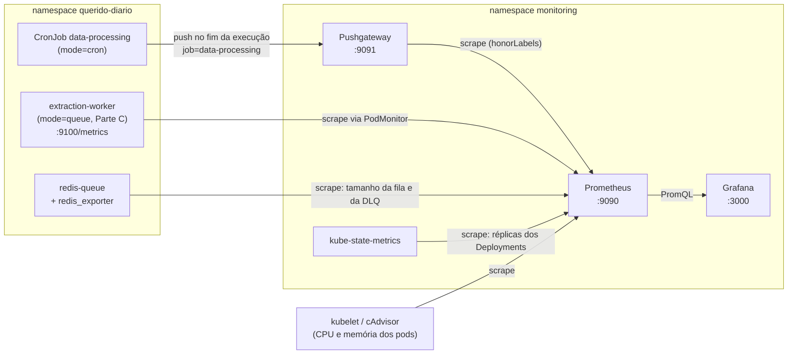

# Observabilidade do pipeline

Este documento explica como funciona a observabilidade do processamento dos diários na expansão estadual: o que é medido, por onde as métricas passam, como ver os números no Grafana e no Prometheus e como interpretar cada painel. A decisão de usar Prometheus + Grafana, e não apenas logs, está na [ADR-0011](adrs/0011-observabilidade-com-prometheus-e-grafana.md).

O código fica em dois repositórios, sempre na branch `main-estados` (ADR-0007):

| O quê | Onde |
|---|---|
| Métricas da aplicação (`qd_*`) | `querido-diario-data-processing/monitoring/metrics.py` |
| Medição de cada diário | `querido-diario-data-processing/tasks/gazette_text_extraction.py` (`observe_gazette_processing`) |
| Envio ao Pushgateway no fim do CronJob | `querido-diario-data-processing/main/__main__.py` (`push_metrics_if_configured`) |
| Instalação da stack no kind | `querido-diario-deployment/scripts/k8s_local_up.py` (`install_monitoring`), alvo `make k8s-local-monitoring` |
| Values do `kube-prometheus-stack` | `querido-diario-deployment/k8s/local/monitoring-values.yaml` |
| Dashboard *Querido Diário / Pipeline* | `querido-diario-deployment/k8s/local/dashboards/qd-pipeline.json` |
| `PIPELINE_MODE` e `PUSHGATEWAY_URL` | `querido-diario-deployment/k8s/base/configmap-app.yaml` (base) e `k8s/overlays/dev/kustomization.yaml` (kind) |

## Visão geral



O Prometheus raspa (*pull*) os alvos a cada 10 s no kind e guarda as séries por 7 dias. O Grafana só consulta o Prometheus; ele não guarda dados.

Há dois caminhos para as métricas da aplicação, porque as duas arquiteturas comparadas no TCC têm processos de natureza diferente:

- **CronJob (arquitetura atual, `mode="cron"`)**: é um processo batch, que roda de hora em hora (`0 * * * *`) e termina. Uma execução sem diários pendentes acaba em segundos, antes de o Prometheus conseguir raspá-la. Por isso, no fim de `execute_pipeline`, o processo *empurra* as métricas para o Pushgateway, que fica de pé e é raspado normalmente.
- **Workers da fila (arquitetura proposta, `mode="queue"`)**: são processos de longa duração. Cada worker expõe `/metrics` na porta `METRICS_PORT` (padrão 9100) com `start_metrics_server()`, e o Prometheus o raspa via `PodMonitor`. Esse caminho entra com a Parte C (#21 e #24).

As duas arquiteturas usam as mesmas três métricas, e o rótulo `mode` separa uma da outra. É isso que torna os números comparáveis nos experimentos.

## O que é medido

### Métricas da aplicação

Definidas em `monitoring/metrics.py`, num registry próprio (`CollectorRegistry`) que contém só estas séries. A medição envolve a chamada de `try_process_gazette_file`, então cada diário gera exatamente uma observação.

| Métrica | Tipo | Rótulos | O que significa |
|---|---|---|---|
| `qd_gazettes_processed_total` | Counter | `mode`, `status` | Quantos diários terminaram o processamento, por resultado |
| `qd_gazette_processing_seconds` | Histogram | `mode` | Quanto tempo levou cada diário, do download à indexação no OpenSearch |
| `qd_scrape_to_index_seconds` | Histogram | `mode` | Quanto tempo se passou entre a coleta pelo raspador (`scraped_at`) e o fim da indexação |

Valores do rótulo `status`:

| `status` | Quando |
|---|---|
| `ok` | O diário foi extraído, segmentado e indexado sem erro |
| `unsupported` | O tipo de arquivo não é suportado (`UnsupportedFileTypeError`) |
| `error` | Qualquer outra exceção durante o processamento, inclusive arquivo ausente no storage (404) |

Detalhes que importam na leitura:

- `qd_scrape_to_index_seconds` só é observado para diários `ok`. Ele mede o atraso que o usuário percebe: quanto tempo um diário coletado demora para aparecer na busca. No CronJob, esse valor inclui a espera até a próxima execução de hora em hora, e é justamente aí que a fila deve mostrar diferença.
- `scraped_at` é gravado pelos raspadores em UTC sem fuso, e o código o trata como UTC.
- Histogramas no Prometheus viram três séries: `_bucket{le="..."}` (contagem acumulada por limite), `_sum` (soma dos tempos) e `_count` (número de observações). Os percentis são estimados a partir dos buckets com `histogram_quantile`, então a precisão depende dos limites escolhidos:
  - `qd_gazette_processing_seconds`: 1, 2, 5, 10, 20, 40, 80, 160 e 320 s.
  - `qd_scrape_to_index_seconds`: 1 min, 5 min, 15 min, 30 min, 1 h, 2 h, 4 h, 12 h e 24 h.

  Um p95 de "0,95 s" no tempo por diário quer dizer "abaixo do primeiro bucket", interpolado entre 0 e 1 s, e não uma medida exata.

### Métricas do cluster

Vêm do `kube-prometheus-stack`, sem nenhum código nosso:

| Métrica | Origem | Uso |
|---|---|---|
| `container_cpu_usage_seconds_total` | kubelet/cAdvisor | CPU por pod (com `rate()`, em cores) |
| `container_memory_working_set_bytes` | kubelet/cAdvisor | Memória por pod (é o valor que o Kubernetes usa para OOMKill) |
| `kube_deployment_spec_replicas` | kube-state-metrics | Réplicas desejadas de um Deployment (o que o KEDA/HPA pediu) |
| `kube_deployment_status_replicas` / `_available` | kube-state-metrics | Réplicas existentes / prontas |
| `redis_key_size{key="..."}` | redis_exporter (Parte C) | Tamanho de uma lista no Redis: a fila `extraction` e a DLQ `qd:extraction:dead` |

### Métricas do Pushgateway

O Pushgateway acrescenta, para cada grupo recebido, `push_time_seconds{job="data-processing"}`, o horário Unix do último push. É a forma de saber quando o CronJob rodou pela última vez.

## Como subir e ver no kind

Pré-requisito: o cluster local de pé (`make k8s-local-up`, no `querido-diario-deployment`). O monitoramento fica fora do `k8s-local-up` porque pesa cerca de 1 GB de RAM.

```bash
cd querido-diario-deployment
make k8s-local-monitoring   # kube-prometheus-stack + Pushgateway + dashboards (namespace monitoring)
make k8s-local-grafana      # port-forward: http://localhost:3000  (admin / admin)
```

Se a porta 3000 estiver ocupada: `make k8s-local-grafana GRAFANA_PORT=3001`.

No Grafana, o dashboard fica em **Dashboards → Querido Diário / Pipeline**. Os dashboards padrão do `kube-prometheus-stack` (por exemplo *Kubernetes / Compute Resources / Namespace (Pods)*) também estão lá e são úteis para olhar o cluster como um todo.

Para gerar dados, dispare uma execução do CronJob:

```bash
make k8s-local-data-processing
kubectl get jobs -n querido-diario                          # pegue o nome do Job criado
kubectl logs -n querido-diario job/<nome-do-job> -f         # procure "Métricas enviadas ao Pushgateway"
```

Se não houver diários pendentes, a execução não processa nada e os contadores ficam vazios. Para reprocessar alguns, marque-os como pendentes no Postgres local (`UPDATE gazettes SET processed = false WHERE id IN (...)`).

Outras interfaces, úteis para depurar:

```bash
# Prometheus: http://localhost:9090 (Graph para testar PromQL; Status → Targets para ver os alvos)
kubectl port-forward -n monitoring svc/monitoring-kube-prometheus-prometheus 9090:9090

# Pushgateway: http://localhost:9091 (mostra o último push de cada job)
kubectl port-forward -n monitoring svc/pushgateway-prometheus-pushgateway 9091:9091
```

### Editar o dashboard

O JSON versionado vira um ConfigMap com a label `grafana_dashboard: "1"`, que o sidecar do Grafana carrega sozinho. Para mudar um painel:

1. Edite no Grafana e salve.
2. Exporte o JSON (**Share → Export**, sem marcar *Export for sharing externally*) por cima de `k8s/local/dashboards/qd-pipeline.json`.
3. Rode `make k8s-local-dashboards` e faça o commit do JSON.

Alterações feitas só na interface se perdem quando o pod do Grafana reinicia.

## O dashboard *Querido Diário / Pipeline*

O dashboard tem quatro variáveis no topo:

| Variável | Para que serve |
|---|---|
| Fonte de dados | O datasource Prometheus; no Revoada será o que o cluster oferecer (#42) |
| Namespace | Namespace dos painéis de fila, réplicas e recursos (padrão `querido-diario`) |
| Pod | Filtra os painéis de CPU e memória |
| Janela dos percentis | Janela do `rate()` usado nos percentis do modo fila (5 min a 6 h, padrão 1 h) |

### Linha 1: última execução do CronJob (Pushgateway)

Números da última execução, lidos diretamente do Pushgateway, e não acumulados.

| Painel | O que mostra | Consulta |
|---|---|---|
| Último push | Quando o CronJob enviou métricas pela última vez | `max(push_time_seconds{job="data-processing"}) * 1000` |
| Diários por status | Quantos diários a última execução processou, por `status` | `sum by (status) (qd_gazettes_processed_total{job="data-processing"})` |
| Vazão da execução | Diários por minuto de processamento, ou seja, quantidade ÷ tempo somado de processamento | `60 * sum(..._count) / sum(..._sum)` |
| Tempo por diário (p50 / p95) | Percentis do histograma da última execução | `histogram_quantile(0.95, sum by (le) (qd_gazette_processing_seconds_bucket{job="data-processing"}))` |
| Coleta → indexado (p50 / p95) | Idem, para a latência desde a coleta | mesma forma, com `qd_scrape_to_index_seconds_bucket` |

A "vazão da execução" desconsidera o tempo de inicialização do Job e as consultas ao banco fora do processamento de cada diário. Ela mede a velocidade do processamento em si, e não a do Job inteiro.

### Linha 2: vazão e tempos por diário

Séries ao longo do tempo, para comparar os modos.

- **Vazão por modo e status**: `60 * sum by (mode, status) (rate(qd_gazettes_processed_total[5m]))`, em diários por minuto. Para a fila, é a vazão contínua. Para o CronJob, cada execução aparece como um pico de até 5 minutos, porque o contador só existe enquanto o Pushgateway guarda aquele push (veja [Limitações](#limitações-e-cuidados-na-leitura)). A série "cron · última execução" repete a vazão da linha 1 como referência.
- **Tempo por diário (p50 / p95)**: para a fila, `histogram_quantile` sobre `rate(...[$janela])`. Para o CronJob, os percentis do histograma da última execução, que aparecem como um degrau a cada push.
- **Latência coleta → indexado (p50 / p95)**: mesma lógica, com `qd_scrape_to_index_seconds`.

### Linha 3: fila de extração (Parte C)

Fica vazia até a fila subir (overlay `dev-queue`, que entra com a C6, #24).

- **Profundidade da fila e DLQ**: `redis_key_size` das chaves `extraction` (diários aguardando um worker) e `qd:extraction:dead` (diários que esgotaram as tentativas). Uma fila que cresce sem parar indica workers insuficientes; uma DLQ que cresce indica falhas a investigar. O `redis_exporter` precisa de `REDIS_EXPORTER_CHECK_SINGLE_KEYS=db0=extraction,db0=qd:extraction:dead`, senão essas séries não existem.
- **Réplicas do extraction-worker**: desejadas (o que o KEDA pediu), existentes e disponíveis. A distância entre "desejadas" e "disponíveis" é o tempo de subida de um worker, um dos números do experimento de elasticidade.

### Linha 4: recursos por pod

- **CPU por pod**: `rate(container_cpu_usage_seconds_total[$__rate_interval])`, em cores (1 = um núcleo inteiro).
- **Memória por pod (working set)**: `container_memory_working_set_bytes`.

O filtro `container!="", image!=""` remove as séries agregadas do cgroup do pod, que duplicariam os valores.

## Limitações e cuidados na leitura

**O Pushgateway guarda só a última execução.** Cada push do CronJob substitui o grupo `job="data-processing"` inteiro, então os contadores e histogramas "zeram" a cada execução. O histórico não se perde: o Prometheus raspou o Pushgateway a cada 10 s e guardou cada valor. As consequências práticas são:

- para "quanto a última execução processou", use o valor direto (linha 1), e não `increase()`;
- `rate()` e `increase()` tratam a troca de valores como um reset de contador, por isso funcionam, mas mostram cada execução como um pico curto;
- percentis do CronJob com `rate(...[janela])` só fazem sentido se a janela cobrir pelo menos uma execução (o CronJob roda de hora em hora, então uma janela de 1 h ou mais).

**O Pushgateway continua expondo a última execução indefinidamente.** Ele não expira os valores (só os perde se o pod reiniciar, porque roda sem persistência), então, se o CronJob parar de rodar, a linha 1 continua mostrando os números antigos. Confira sempre o painel "Último push".

**O push é feito só no fim da execução.** Uma execução longa não aparece no dashboard enquanto roda, e uma execução que morre antes do fim (OOMKill, por exemplo) não envia nada. Nesses casos, os logs do Job são a fonte.

**Falha no envio não derruba o pipeline.** Se o Pushgateway estiver fora do ar, o log mostra `Falha ao enviar métricas ao Pushgateway` e o processamento termina normalmente. O mesmo vale para `PUSHGATEWAY_URL` vazia, que é o padrão da base do `app-config`: nada é enviado.

**Workers não exportam métricas de processo do Python.** O registry próprio deixa de fora `process_cpu_seconds_total` e similares, de propósito. Para CPU e memória, use as métricas do cAdvisor da linha 4.

## Variáveis de ambiente

| Variável | Padrão | Efeito |
|---|---|---|
| `PIPELINE_MODE` | `cron` | Valor do rótulo `mode`. Os workers da fila usam `queue` |
| `PUSHGATEWAY_URL` | vazia | Endereço do Pushgateway. No overlay dev: `pushgateway-prometheus-pushgateway.monitoring:9091`. Vazia = não envia |
| `METRICS_PORT` | `9100` | Porta do `/metrics` dos workers |

## Consultas úteis

Para testar no Prometheus (aba *Graph*) ou em **Explore** no Grafana:

```promql
# Todos os diários do último push do CronJob, por status
qd_gazettes_processed_total{job="data-processing"}

# Há quanto tempo foi o último push (em segundos)
time() - push_time_seconds{job="data-processing"}

# Tempo médio por diário na última execução do CronJob
sum(qd_gazette_processing_seconds_sum{job="data-processing"})
  / sum(qd_gazette_processing_seconds_count{job="data-processing"})

# Vazão da fila na última hora, em diários por minuto
60 * sum(rate(qd_gazettes_processed_total{mode="queue", status="ok"}[1h]))

# p95 da latência coleta → indexado da fila na última hora
histogram_quantile(0.95, sum by (le) (rate(qd_scrape_to_index_seconds_bucket{mode="queue"}[1h])))

# Taxa de erro da fila (fração dos diários com status error)
sum(rate(qd_gazettes_processed_total{mode="queue", status="error"}[15m]))
  / sum(rate(qd_gazettes_processed_total{mode="queue"}[15m]))
```

## Problemas comuns

| Sintoma | Causa provável | O que fazer |
|---|---|---|
| Nenhuma série `qd_*` no Prometheus | `PUSHGATEWAY_URL` vazia no `app-config` do cluster | `kubectl get cm app-config -n querido-diario -o yaml \| grep PUSHGATEWAY`; reaplique o overlay dev |
| Log do Job sem "Métricas enviadas ao Pushgateway" e sem aviso de falha | Imagem antiga, sem `monitoring/metrics.py` ou sem `prometheus-client` | Reconstrua a imagem base (`make build-data-processing-base`) e a imagem local (`make k8s-local-data-processing-build`) |
| Séries aparecem com `job="pushgateway-prometheus-pushgateway"` e o dashboard fica vazio | O Prometheus raspa o Pushgateway sem `honorLabels` | O `install_monitoring` instala com `serviceMonitor.honorLabels=true`; rode `make k8s-local-monitoring` de novo |
| Pushgateway sem alvo em *Status → Targets* | ServiceMonitor do Pushgateway desabilitado | Mesmo caso acima: `serviceMonitor.enabled=true` |
| Linha 1 com valores zerados ou vazios | A última execução não tinha diários pendentes | Marque diários como `processed = false` e rode `make k8s-local-data-processing` |
| Painéis da fila vazios | A fila da Parte C não está no ar, ou o `redis_exporter` não exporta as chaves | Suba o overlay `dev-queue` (C6, #24) e confira `REDIS_EXPORTER_CHECK_SINGLE_KEYS` |
| Dashboard sumiu ou voltou à versão antiga | Edição feita só na interface do Grafana | Exporte o JSON para o repositório e rode `make k8s-local-dashboards` |

## No Revoada

No cluster compartilhado não instalamos outro `kube-prometheus-stack`: a ideia é usar o Grafana que já existe e um Prometheus que colete o namespace de testes. O que ainda depende dos administradores do cluster está na issue #42:

- qual datasource Prometheus usar e se ele coleta `ServiceMonitor`/`PodMonitor` do namespace de testes;
- se há Pushgateway disponível ou se podemos subir um no namespace; quando houver, definir `PUSHGATEWAY_URL` no overlay do Revoada e garantir `honorLabels: true` no scrape;
- se o Grafana carrega dashboards de ConfigMaps com a label `grafana_dashboard` ou se o `qd-pipeline.json` precisa ser importado à mão (**Dashboards → New → Import**). O dashboard já usa a variável *Fonte de dados*, então funciona com qualquer datasource Prometheus.

Esta seção deve ser atualizada quando a #42 for respondida.
