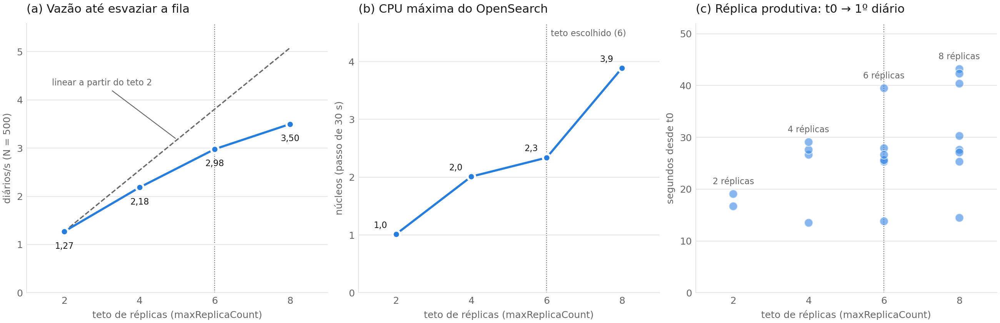

# D5 · Calibração do teto de réplicas (#31)

Cenário E1 no modo C, N = 500, *seed* 1, uma execução por teto (2, 4, 6 e 8), no Revoada, em 26/11/2026, logo depois do piloto da campanha R. Todas as execuções foram válidas. O teto escolhido foi **6**, que passou a valer no modo C da campanha R.

## Vazão e teto

| Teto | t0 → t_vazio | Diários/s | Ganho por réplica a mais | CPU máx. do OpenSearch (núcleos) |
|---|---|---|---|---|
| 2 | 394 s | 1,27 | — | 1,0 |
| 4 | 229 s | 2,18 | 0,45 | 2,0 |
| 6 | 168 s | 2,98 | 0,40 | 2,3 |
| 8 | 143 s | 3,50 | 0,26 | 3,9 |

Até o teto 6, cada réplica a mais rende ~0,4 diário/s. De 6 para 8, rende pouco mais da metade disso (0,26), e a CPU do OpenSearch quase dobra. Por isso o joelho da curva fica no **6**.

## Cold start de cada scale-up

Para cada réplica, o cold start é o intervalo entre a criação do pod e o fim do primeiro diário que ela processa. Os instantes vêm do Prometheus do Revoada, extraídos por [`simulador/cold_start.py`](../../../simulador/cold_start.py) e guardados em [`E1/C/cold-start.csv`](E1/C/cold-start.csv), já que o Prometheus guarda só 1 dia:

- criação, agendamento, início do contêiner `worker` e Ready vêm do kube-state-metrics, com resolução de 1 s;
- o fim do 1º diário vem de `qd_gazettes_processed_created`. O contador tem rótulos, então o prometheus_client só cria a série no primeiro `.labels()`, que acontece no fim do primeiro diário.

O Tika é *native sidecar* com `startupProbe` a cada 5 s (ADR-0010), e o `worker` só inicia depois de a JVM responder. Por isso o intervalo "criado → worker" inclui o agendamento, a criação dos contêineres e a JVM do Tika. Já o intervalo "worker → 1º diário" inclui a inicialização do worker e o processamento do próprio diário.

| Teto | Réplicas | Criado → worker (mediana) | Cold start, criado → 1º diário (mediana; mín.–máx.) | Última réplica produtiva (desde t0) | Réplica·s antes do 1º diário, sobre teto × (t_vazio − t0) |
|---|---|---|---|---|---|
| 2 | 2 | 6 s | 11,7 s (11,0–12,4) | 19 s | 4,5% |
| 4 | 4 | 6 s | 11,4 s (9,8–13,4) | 29 s | 10,6% |
| 6 | 6 | 6 s | 10,9 s (10,0–13,4) | 40 s | 15,8% |
| 8 | 8 | 7 s | 13,9 s (10,2–17,0) | 43 s | 21,9% |

Nos 20 pods, o cold start teve mediana de **12 s** e variou de 9,8 a 17,0 s. É menos que os 20 a 30 s previstos na ADR-0010 (estimativa do kind): nas hipos, a JVM do Tika responde à `startupProbe` em até ~6 s.

O que mais pesa nos tetos altos não é o cold start de cada pod, que fica estável entre 10 e 14 s, mas a **subida em ondas** do HPA. Os pods são criados em ~t0 + 4 s (a 1ª réplica), em ~t0 + 13–16 s e em ~t0 + 28–30 s, e cada onda ainda paga o próprio cold start. Com teto 8, a última réplica só fica produtiva 43 s depois de t0, e a fila esvazia em 143 s. Assim, ~22% da capacidade nominal (réplica·s) se perde antes de cada réplica concluir o 1º diário, contra 4,5% com teto 2. Esse custo da subida, que cresce com o teto, é mais uma razão para não passar de 6.
